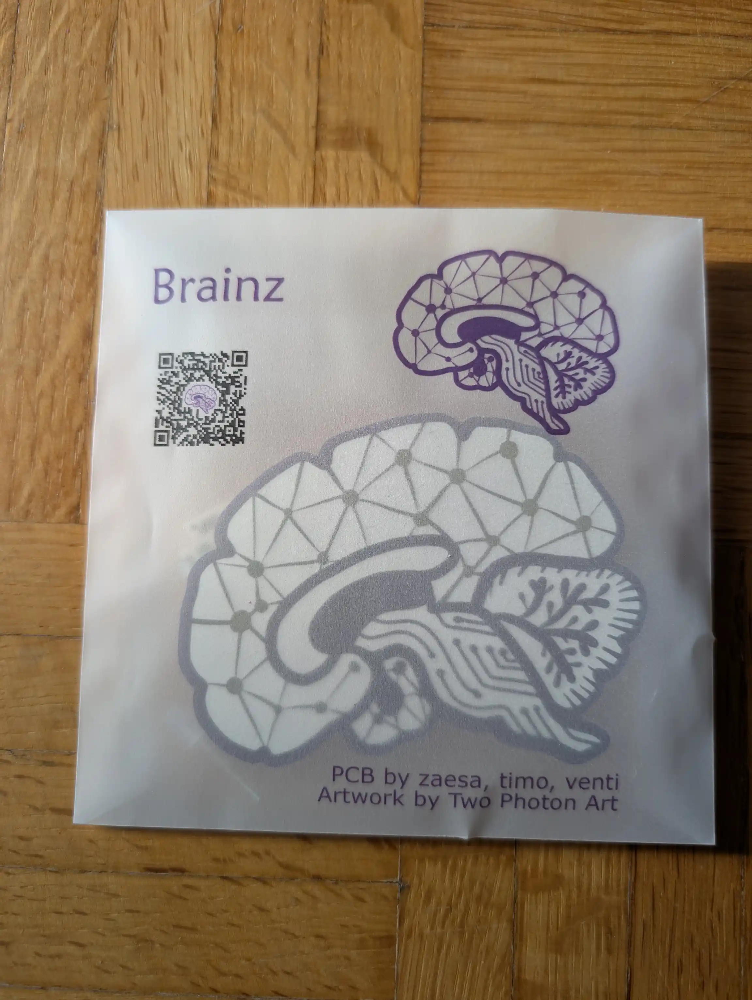
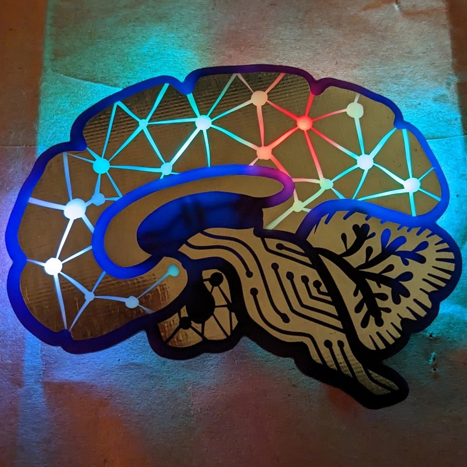

# Brainz

A brain that lights up: four RGB LEDs shine through the translucent PCB artwork on the front.

- Difficulty: **2/5**

### Parts List

| Description                   | Quantity |
|-------------------------------|----------|
| RGB LEDs 5mm                  |     4    |
| Switch (Button)               |     1    |
| CR2032 Battery Holder         |     1    |
| CR2032 Battery (not included, available at distribution) | 1 |
| Brainz (PCB)                  |     1    |
| Pin / brooch pin (optional, at distribution) | 1 |

### Manuals

- [German](manual/Brainz_de.pdf) / [English](manual/Brainz_en.pdf)
- [Interactive Board](ibom.html)

### Design files

PCB Gerber and KiCad files are available

### Packaging

A square 125mm x 125m translucent envelope, laser printed

### Copyright and Authorship

- Board: [CC-BY-SA 4.0](https://creativecommons.org/licenses/by-nc-sa/4.0/deed.de) - Binary Kitchen e.V.
- PCB design: zaesa & Timo
- Artwork: Two Photon Art - [CC-BY-SA-NC 4.0](https://creativecommons.org/licenses/by-nc-sa/4.0/deed.de)
The Artwork is licensed non commercial only and only for this project.

### Get Soldering Kits

Ask Binary Kitchen e.V., we are present on several hacker events. Donations are always welcome
