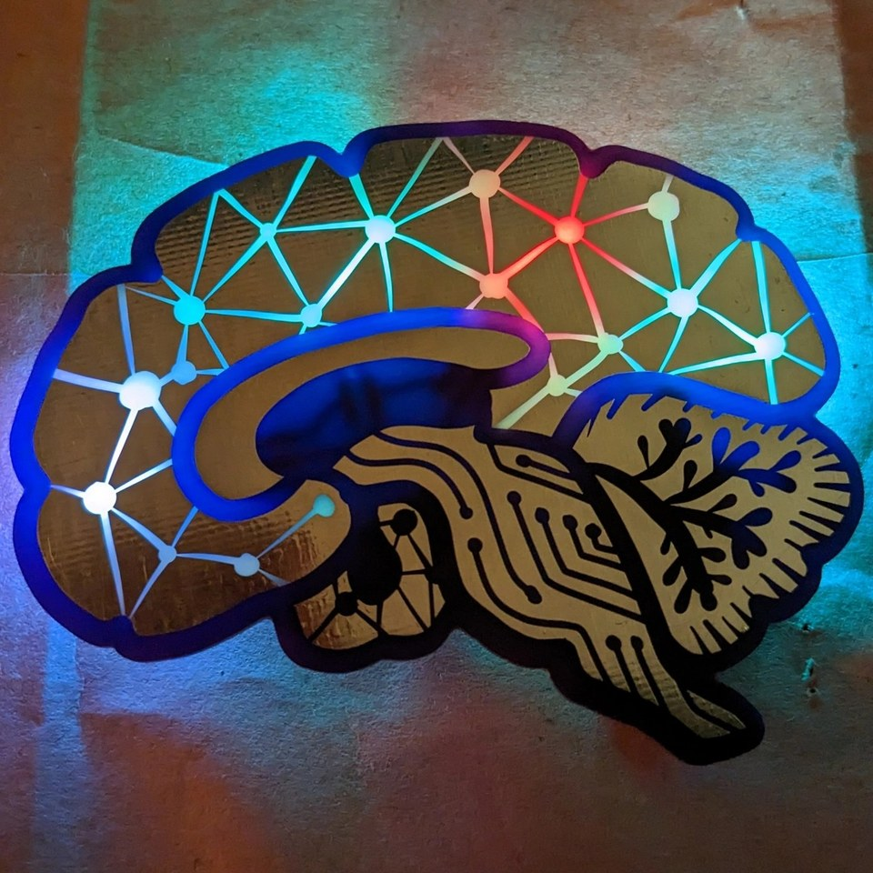
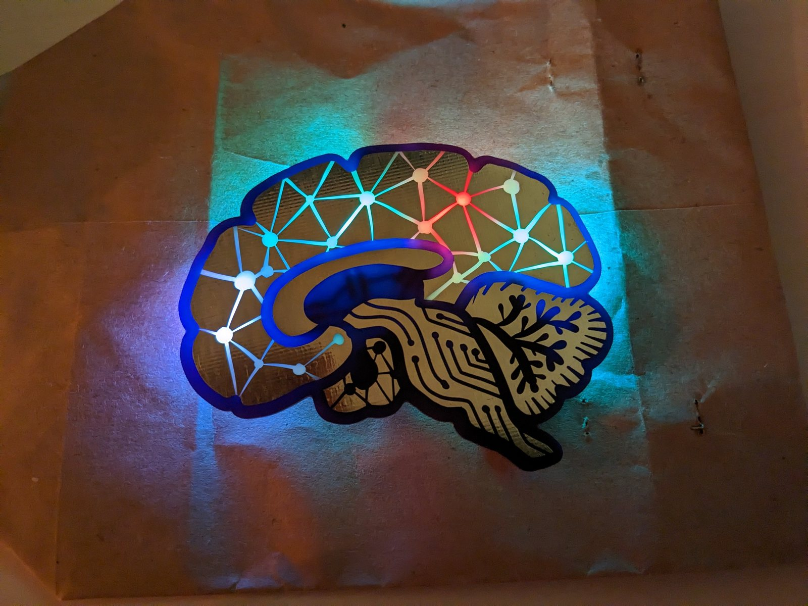

# Brainz

A brain that lights up: four RGB LEDs shine through the PCB artwork on the front.

 

- Status: **Draft**
- Difficulty: **2/5**

### Parts List

| Description                   | Quantity |
|-------------------------------|----------|
| RGB LEDs 5mm                  |     4    |
| Button                        |     1    |
| CR2032 Battery Holder         |     1    |
| CR2032 Battery (not included, available at distribution) | 1 |
| Brainz (PCB)                  |     1    |
| Pin / brooch pin (optional, at distribution) | 1 |

### Manuals

- [German](manual/Brainz_de.pdf) / [English](manual/Brainz_en.pdf) - generated by `make manuals`, do not edit by hand
- [Interactive Board](ibom.html) - not generated yet

### Design files

PCB Gerber files and the design sources will follow, pending finishing touches.

### Copyright and Authorship

- Board: [CC-BY-SA 4.0](https://creativecommons.org/licenses/by-sa/4.0/) - Binary Kitchen e.V.
- PCB design: zaesa & Timo
- Artwork: Two Photon Art - [CC-BY-SA 4.0](https://creativecommons.org/licenses/by-sa/4.0/)

### Buy Soldering Kits

TODO: shop link, if available
