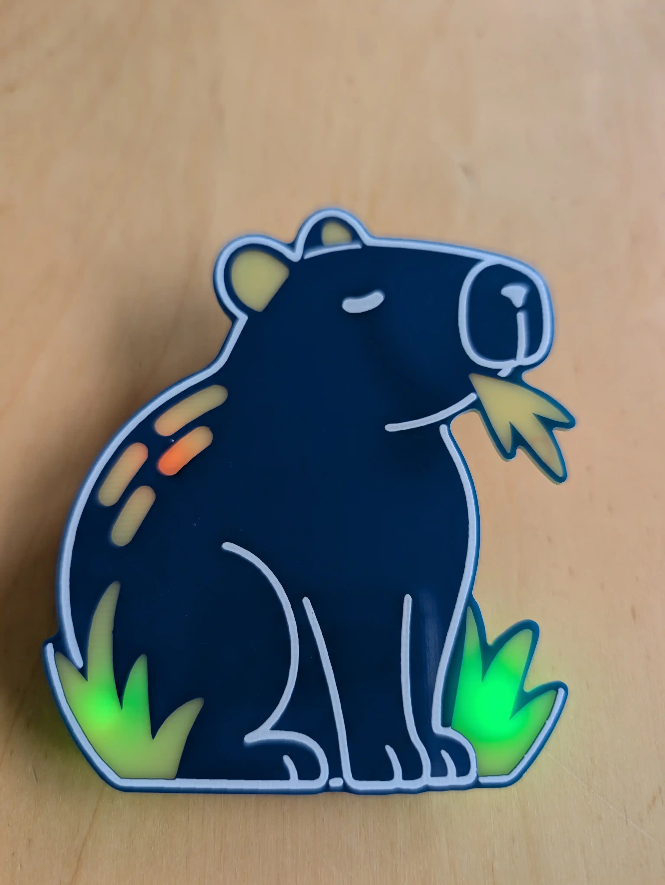
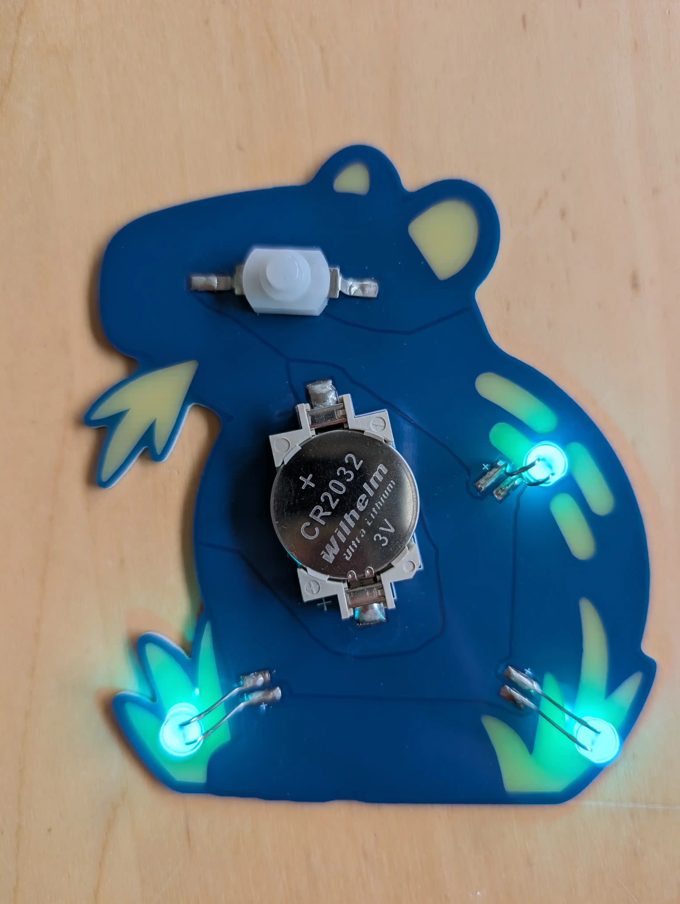

# Cabybara

A simple RBG LED badge

Made by Alex and Clemens, using Alex' [PCB Designer](https://alber.me/miscellaneous/tools/pcb-designer.html), which generated Gerber and KiCAD files

## Interactive Schematics

[Interactive Schematics](ibom.html)

## Front

## Back

