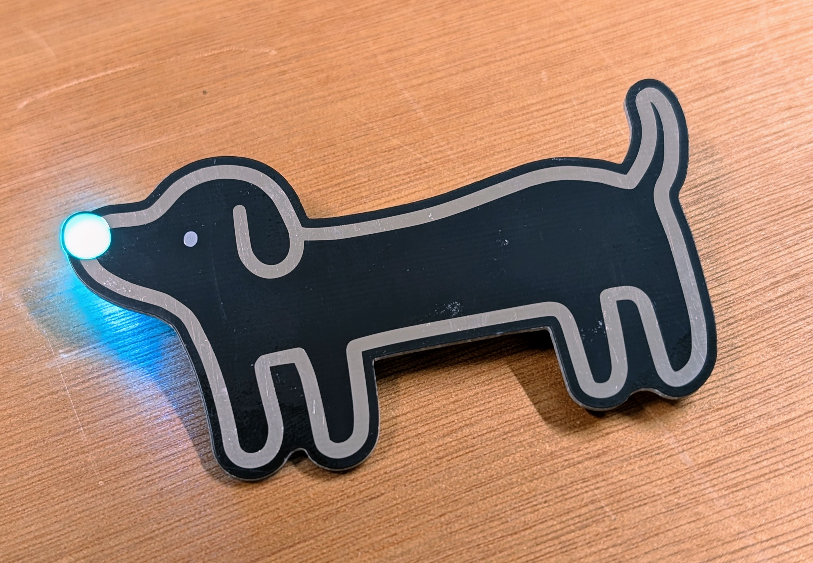
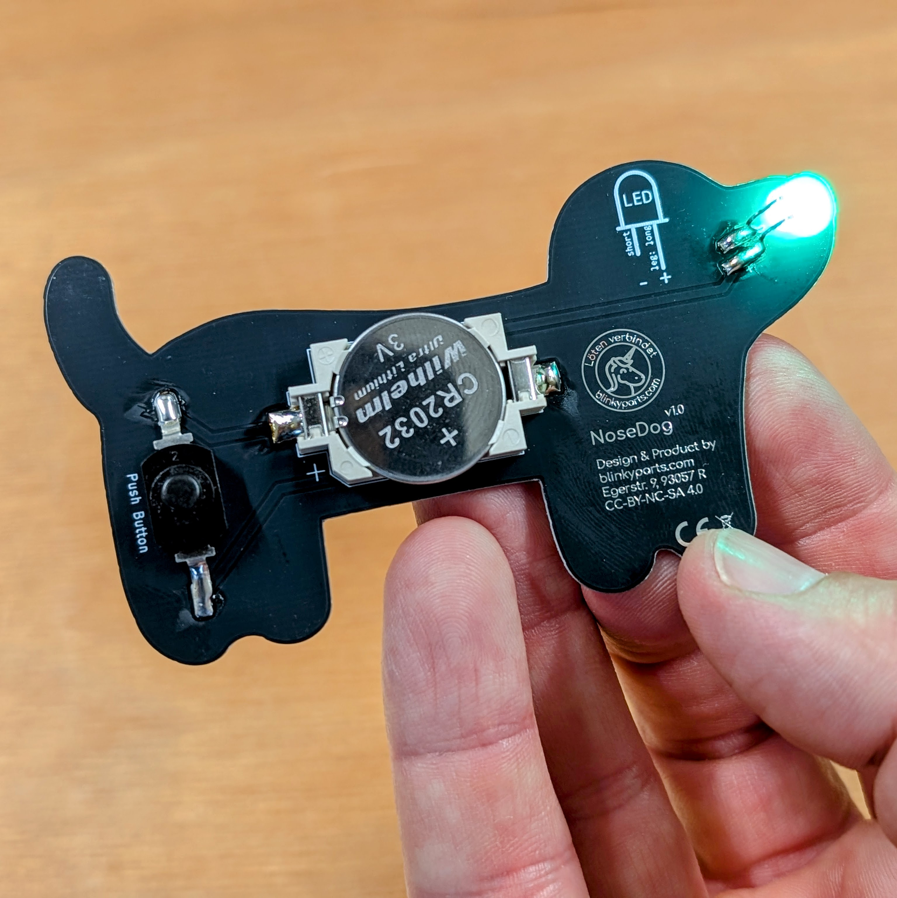

# NoseDog

Unser erster Hund in der Familie. NoseDog leuchtet euch den Weg mit seiner leuchtenden Nase.

 

- Status: **Complete**
- Difficulty: **2/5**

### Parts List

| Description                   | Quantity |
|-------------------------------|----------|
| RGB LEDs 5mm                  |     1    |
| Button (SMD)                  |     1    |
| CR2032 Battery Holder (SMD)   |     1    |
| CR2032 Battery (not included) |     1    |

### Copyright and Authorship

- Board: [CC-BY-NC-SA 4.0](https://creativecommons.org/licenses/by-nc-sa/4.0/) - blinkyparts GmbH
- Dachshund Form [CC-BY-SA](https://creativecommons.org/licenses/by-sa/4.0/) - [Created by hyojung kang from Noun Project](https://thenounproject.com/icon/dachshund-6282276/) (We've bought a licence, you should honor the artist work too!)

### Buy Soldering Kits
If you want to buy the parts and PCB for a soldering kit you can find everything here: [shop.blinkyparts.com](https://shop.blinkyparts.com/de/NoseDog-Der-Hund-mit-der-Leuchtnase/blink23227)
